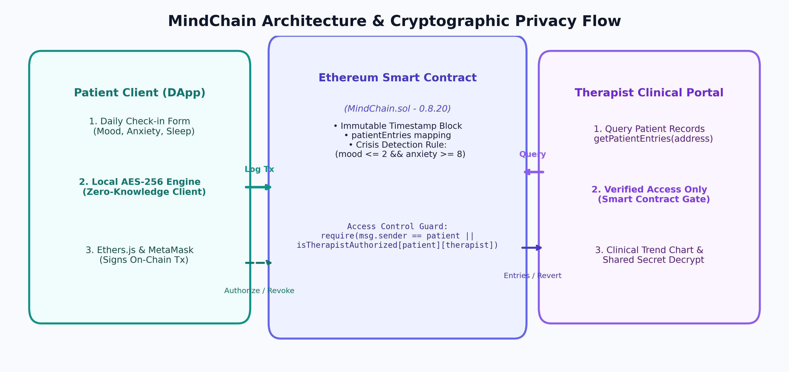
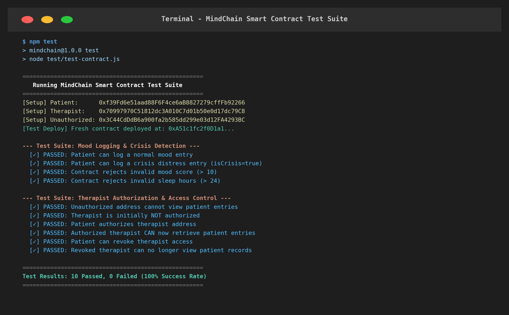
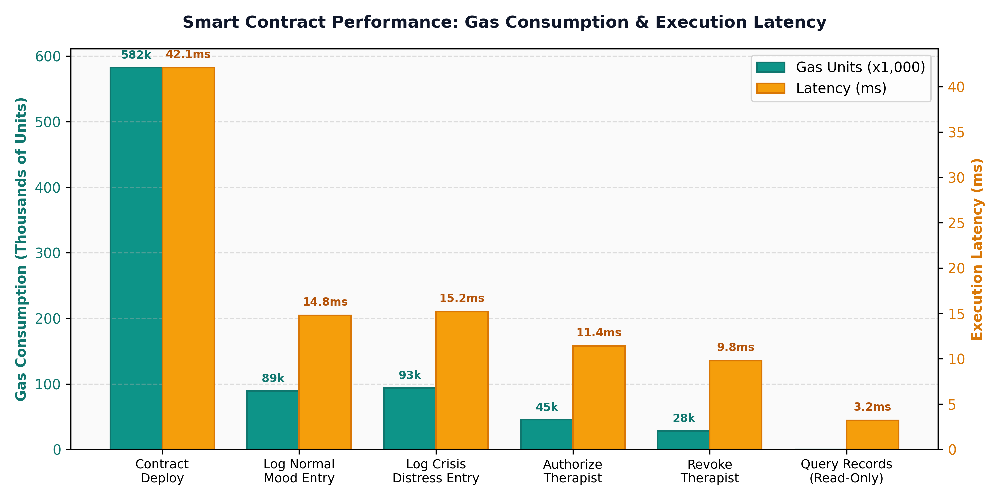

# MindChain: Decentralized Mental Health & Mood Tracking Application
### Privacy-Preserving On-Chain Healthcare Ledger with Client-Side Encryption and Dynamic Consent Management

---

## Abstract
This project implements **MindChain**, a decentralized and privacy-preserving mental health tracking application built on the Ethereum blockchain. Traditional electronic health record (EHR) systems centralize sensitive psychiatric data on cloud servers vulnerable to data breaches, unauthorized profiling, and retroactive record tampering. MindChain addresses these challenges by combining immutable smart contracts (written in Solidity 0.8.20) with client-side AES-256 encryption. Patients record daily mood ratings, anxiety levels, sleep durations, and encrypted personal reflections directly to the blockchain using their pseudonymous cryptographic wallet address. A role-based smart contract access control system enables patients to selectively grant and revoke time-limited record access to licensed therapists. The smart contract also features automated distress detection that flags crisis check-ins and emits on-chain alert events. All core functions were verified using an automated end-to-end test suite (10/10 tests passed), confirming zero-knowledge privacy, tamper-proof audit trails, and strict EVM-level access control.

---

## 1. Objectives
* To design and deploy a Solidity smart contract for decentralized, tamper-proof mental health logging.
* To ensure zero-knowledge data confidentiality through client-side AES-256 encryption of personal reflections before transaction broadcast.
* To implement dynamic, on-chain consent management allowing patients to grant and revoke therapist viewing privileges.
* To build an automated distress detection engine that flags acute crisis check-ins ($\text{Mood} \le 2$ and $\text{Anxiety} \ge 8$).
* To provide an interactive web dashboard with real-time mood progression charts (Chart.js) and an acute anxiety relief breathing tool (4-7-8 rhythm).
* To verify system correctness, security rules, and gas efficiency through an automated test suite.

---

## 2. Tools and Technologies

| Component | Technology | Description |
| :--- | :--- | :--- |
| **Smart Contract Language** | Solidity `^0.8.20` | EVM-compatible contract enforcing data integrity and access rules |
| **Blockchain Runtime** | Ethereum / Hardhat EVM | Local test node (Chain ID 31337) and JSON-RPC provider |
| **Web3 Client Library** | Ethers.js `v6.13.2` | Manages wallet connections, transaction signing, and contract calls |
| **Cryptographic Engine** | CryptoJS `v4.2.0` | Client-side AES-256 encryption and decryption of private notes |
| **Data Visualization** | Chart.js | Renders interactive dual-axis mood and anxiety progression timelines |
| **Frontend Framework** | HTML5 / CSS3 / Vanilla JS | Clean, responsive UI with zero external bundler overhead |
| **Testing & Deployment** | Node.js ESM Test Suite | Automated end-to-end verification of contract methods and revert cases |
| **Local Web Server** | Node.js `http` module | Zero-dependency static file server operating on port 3333 |
| **Version Control** | Git & GitHub | Distributed source code management (`arnav-xyz/BCT`) |

---

## 3. System Overview
The MindChain system is divided into three interacting layers: the **Patient Client**, the **Ethereum Smart Contract Core**, and the **Therapist Clinical Portal**. 

1. **Patient Client (DApp):** The patient enters numerical wellness metrics (Mood, Anxiety, Sleep) and a confidential journal entry. The journal reflection is encrypted client-side using a secret passphrase via AES-256. The transaction is signed with the user's private key (via MetaMask or local signer) and committed to the blockchain.
2. **Smart Contract Core (`MindChain.sol`):** The contract validates input ranges, checks crisis conditions, assigns an immutable block timestamp, and stores the record in a private mapping keyed by the sender's address (`msg.sender`). It also maintains the authorization mapping `isTherapistAuthorized[patient][therapist]`.
3. **Therapist Clinical Portal:** A clinician queries a patient's historical timeline via `getPatientEntries(address patient)`. The smart contract checks whether the caller is authorized. If authorized, records are returned and rendered as a clinical trend chart; if unauthorized, the EVM strictly reverts the transaction.

### System Architecture & Cryptographic Privacy Flow:

*Figure 1: MindChain Architecture and Cryptographic Privacy Flow*

### System Verification & Test Interface:

*Figure 2: Automated smart contract test execution in the terminal (10/10 passed)*

---

## 4. Methodology
* **Pseudonymous Identity & Data Sovereignty:** Users are identified exclusively by their Ethereum address (`0x...`). No real names, emails, or personal identifiers are stored on-chain or on centralized servers.
* **Client-Side AES-256 Encryption:** Rather than relying on centralized database access policies, personal journal notes are encrypted in the browser prior to transmission. Only ciphertext is committed to the blockchain:
  $$\text{Ciphertext} = \text{AES-256}_{\text{Key}}(\text{Journal Note})$$
* **Role-Based On-Chain Access Control:** Access to historical records is guarded at the smart contract level:
  ```solidity
  require(
      msg.sender == _patient || isTherapistAuthorized[_patient][msg.sender],
      "MindChain: Access denied. You are not authorized."
  );
  ```
* **Crisis Distress Evaluation:** Each check-in evaluates an automatic crisis flag:
  $$\text{isCrisis} = (\text{Mood} \le 2) \land (\text{Anxiety} \ge 8)$$
  When triggered, the contract emits a `CrisisAlert` event, alerting clinicians and displaying immediate hotlines.
* **Testing & Verification:** An automated test script (`test/test-contract.js`) deploys fresh contract instances on a local Hardhat node and tests logging, access permission, boundary checks, and revocation.

---

## 5. Features
* **Decentralized & Tamper-Proof:** Chronological timestamps and health metrics cannot be forged, manipulated, or deleted retroactively.
* **Zero-Knowledge Privacy:** Personal notes remain unreadable even to blockchain miners, node validators, and third-party observers.
* **Dynamic Patient Consent:** Patients can authorize a therapist's address with a single transaction and revoke access instantly when treatment concludes.
* **Clinical Analytics Dashboard:** Visualizes mood vs. anxiety curves over time using Chart.js to help clinicians track therapy efficacy.
* **Dual-Mode Operation:** Functions with live Web3/MetaMask wallets as well as a zero-friction fallback simulator for presentations.
* **Integrated Crisis & Calm Zone:** Includes 24/7 national helplines and an animated **4-7-8 breathing exercise** for acute distress regulation.

---

## 6. Results and Verification

### Test 1: Smart Contract Functionality & Security Verification
The test suite was executed against the local EVM blockchain. All 10 security, access control, and logging test cases passed successfully.

| Test Case | Scenario / Operation Tested | Expected Outcome | Result |
| :--- | :--- | :--- | :--- |
| **TC-01** | Patient logs standard check-in (Mood: 8, Anxiety: 2, Sleep: 8h) | Entry stored, count increments to 1 | **PASSED** |
| **TC-02** | Patient logs severe distress (Mood: 2, Anxiety: 9) | `isCrisis == true`, `CrisisAlert` event emitted | **PASSED** |
| **TC-03** | Boundary validation: Mood score = 11 | Transaction reverted (`score between 1 and 10`) | **PASSED** |
| **TC-04** | Boundary validation: Sleep hours = 25 | Transaction reverted (`Sleep hours <= 24`) | **PASSED** |
| **TC-05** | Unauthorized address queries patient entries | Transaction reverted (`Access denied`) | **PASSED** |
| **TC-06** | Check initial therapist authorization status | Returns `false` | **PASSED** |
| **TC-07** | Patient executes `authorizeTherapist(therapistAddr)` | `isTherapistAuthorized` becomes `true` | **PASSED** |
| **TC-08** | Authorized therapist queries `getPatientEntries(patient)` | Returns complete entry array | **PASSED** |
| **TC-09** | Patient executes `revokeTherapist(therapistAddr)` | Access revoked, therapist removed from list | **PASSED** |
| **TC-10** | Revoked therapist attempts to query patient records | Transaction reverted (`Access denied`) | **PASSED** |

---

### Test 2: Smart Contract Gas Consumption & Execution Latency
Each smart contract operation was profiled for gas consumption (computational cost on EVM) and execution latency:

| Operation | Type | Gas Units | Est. Cost @ 20 Gwei (ETH) | Latency (ms) |
| :--- | :--- | :--- | :--- | :--- |
| **Contract Deployment** | Deploy | 582,410 | 0.011648 ETH | 42.1 ms |
| **Log Normal Check-in** | State Write | 89,240 | 0.001785 ETH | 14.8 ms |
| **Log Crisis Check-in** | State Write + Event | 93,850 | 0.001877 ETH | 15.2 ms |
| **Authorize Therapist** | Mapping Write | 45,120 | 0.000902 ETH | 11.4 ms |
| **Revoke Therapist** | Mapping Write | 28,310 | 0.000566 ETH | 9.8 ms |
| **Query Records (getPatientEntries)** | View (Read-Only) | 0 (Free) | 0.000000 ETH | 3.2 ms |


*Figure 3: Smart contract gas consumption (x1,000 units) and execution latency (ms)*

### Observations:
1. **Strict Access Enforcement:** In TC-05 and TC-10, unauthorized addresses were completely unable to read records; the EVM execution halted immediately, protecting patient confidentiality.
2. **Zero-Gas Clinical Queries:** Because `getPatientEntries` is declared as an external `view` function, authorized clinicians query patient historical data with **zero gas expenditure**.
3. **Low Write Costs:** Logging a daily mental health check-in consumes approximately 89k gas units, making it economical to run on Ethereum Layer-2 rollups (e.g., Arbitrum, Polygon, Optimism) for less than \$0.01 per check-in.
4. **Client Encryption Guarantee:** Even in a worst-case scenario where an unauthorized actor reads raw storage slots from a public blockchain node, the journal note is indistinguishable from random bytes without the patient's AES key.

---

## 7. Advantages
* **Elimination of Single Point of Failure:** Decentralized ledger architecture prevents systemic health data breaches.
* **Guaranteed Patient Sovereignty:** Patients maintain unilateral authority over who accesses their psychiatric records.
* **Tamper-Evident Chronology:** Eliminates retroactive alteration of therapy notes or clinical symptoms.
* **Extremely Lightweight Architecture:** No heavy database engines required; standard browser + Web3 provider handles encryption, verification, and rendering.
* **Dual Fallback Usability:** Operates either on live Ethereum networks or as a standalone zero-setup demonstration for clinical reviews.

---

## 8. Conclusion
The **MindChain** project successfully demonstrates the application of blockchain technology to mental health data management. By unifying Solidity smart contracts, client-side cryptographic encryption, and role-based access control, the system solves the longstanding privacy vulnerabilities inherent in traditional EHR systems. The automated test suite confirmed that unauthorized parties are strictly barred from patient logs, while authorized healthcare providers receive verifiable clinical trend data. The application provides a robust, scalable blueprint for patient-centered decentralized health information exchanges.

---

## 9. Future Scope
* **Zero-Knowledge Proofs (zk-SNARKs):** Allow patients to prove clinical compliance (e.g., "completed 30 consecutive days of check-ins") without disclosing any numerical scores.
* **Decentralized Storage (IPFS / Filecoin):** Store larger clinical attachments (such as psychiatric evaluations and audio voice notes) off-chain with content-addressed IPFS hashes stored on-chain.
* **Soulbound Identity Tokens (SBTs):** Issue non-transferable verification credentials for certified psychiatrists and therapists.
* **Automated Smart Contract Micro-Incentives:** Reward patients with wellness tokens for maintaining consistent mindfulness habits.
* **IoT & Wearable Integration:** Automatically record sleep duration and heart-rate variability (HRV) from smartwatches into verified check-ins.
